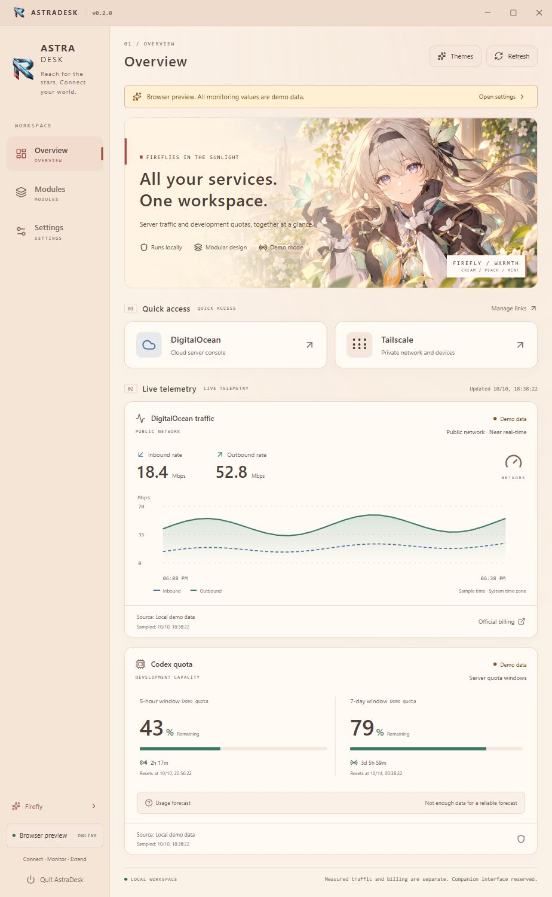

# AstraDesk

A modular Windows workspace for service links, DigitalOcean traffic and Codex quotas. **v0.2.1 Beta** defaults to the warm Firefly theme and supports Chinese and English.

[Windows x64 installer](https://github.com/lonely-bonnie/software-integration/releases/download/v0.2.1/AstraDesk-0.2.1-windows-x64-setup.exe) · [Release and checksums](https://github.com/lonely-bonnie/software-integration/releases/tag/v0.2.1) · [中文](README.md)

The installer includes the desktop runtime. Choose a location and an optional desktop shortcut; uninstall through Windows Installed apps. No Node.js installation is required. A portable EXE is also available.

Use Settings to change language, themes, units, refresh intervals, time zone, startup behavior and reduced motion. Preview changes and save them to keep them. Export profiles exclude tokens, Droplet IDs and local Codex paths; imports are reviewed before saving.

Service links work without monitoring credentials. DigitalOcean monitoring requires your read-only token with `monitoring:read` and a Droplet ID. Codex monitoring requires your local, signed-in Codex CLI. Queries are read-only and do not run inference.

Settings and Windows-encrypted credentials use `%APPDATA%/AstraDesk`. The first upgrade verifies and copies legacy settings and encrypted credentials, retaining originals for rollback. Existing new data is never overwritten; failed migration keeps the original directory active and shows a warning. Normal upgrades and uninstalls keep personal settings. Each friend should configure their own connections. Live failures do not silently switch to demo data.

This beta is unsigned and has manual downloads rather than automatic updates. It has been validated on the maintainer's Windows machine; acceptance on a separate PC is still pending. Billing totals, third-party code plugins and desktop companion windows are not implemented.

For a normal checkout, run `npm ci`, `npm test`, `npm run build`, then `npm run dev:desktop`. `npm run release:win` checks formatting, tests and types, builds the UI, packages installer and portable EXEs, and writes SHA256 checksums. See [contributing](CONTRIBUTING.md) and [engineering](docs/ENGINEERING.md).

Development dependencies and tools live in `AstraDesk-Dev`. Versioned installers are directly in `AstraDesk-Dev/releases`; intermediate packages use `.build`. Existing releases cannot be overwritten. Run `npm run releases:check` to verify the archive and `npm run clean` after package validation. See [directory and release conventions](docs/RELEASES.md).

Theme art is AI-generated fan concept artwork, not official artwork or an endorsement. The public repository currently uses UNLICENSED and does not grant an open-source reuse license.
