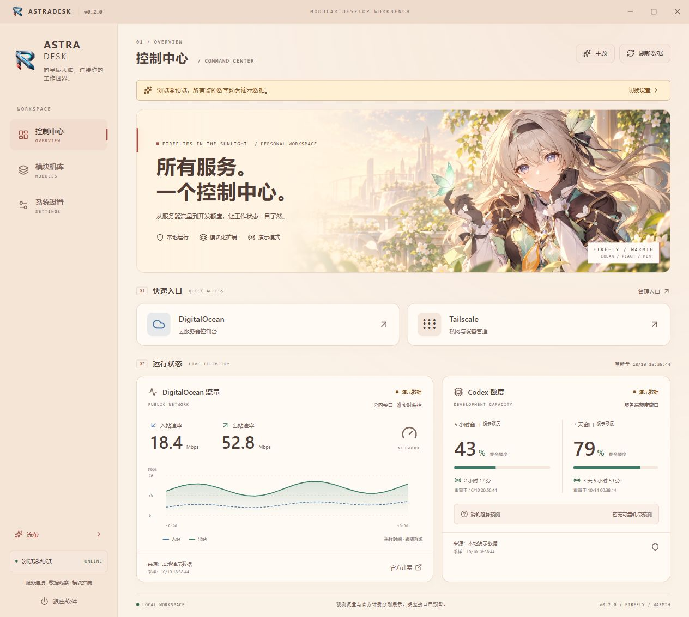

# AstraDesk · 星辰大海，从桌面开始

AstraDesk 是可扩展的 Windows 桌面工作台：常用网站、DigitalOcean 流量和 Codex 额度集中展示。**0.2.1 Beta** 默认使用暖色流萤主题，支持中英文界面。

[下载安装版](https://github.com/lonely-bonnie/software-integration/releases/download/v0.2.1/AstraDesk-0.2.1-windows-x64-setup.exe) · [发行与校验文件](https://github.com/lonely-bonnie/software-integration/releases/tag/v0.2.1) · [English](README.en.md)



## 安装与使用

1. 下载 Windows x64 安装 EXE，选择安装语言、安装位置和是否创建桌面快捷方式。
2. 运行 AstraDesk 即可使用 DigitalOcean、Tailscale 入口。朋友无需安装 Node.js 或开发工具。
3. 打开“系统设置”：切换语言、主题、速率单位、刷新间隔、时区和窗口行为；点击保存后记住设置。
4. 需要 DO 监控时，填写自己的 Droplet ID 和包含 `monitoring:read` 的只读 Token。
5. Codex 监控需要本机已安装并登录 Codex CLI；自动发现失败时可指定 `codex.exe` 的完整路径。未配置监控不影响网站入口。
6. 关闭窗口默认收起到托盘；侧栏和托盘的“退出”会完全退出。通过 Windows“已安装的应用”可卸载。

安装包完整包含桌面运行环境；约 121 MiB 下载、415 MiB 程序空间。另提供便携版。当前发行未签名，尚未在另一台独立电脑验收；使用手动下载更新入口，没有后台自动更新。

## 功能与设置

- 网站入口：内置 DO / Tailscale；添加、删除自定义 HTTPS 网站，使用系统浏览器打开。
- DO 公网入站、出站准实时速率、最近 30 分钟趋势、采样状态与 Mbps / MB/s。观测值不等于官方计费累计。
- Codex 官方 CLI App Server 只读额度窗口、官方重置倒计时、满足采样条件时的耗尽预测。
- 四主题：默认流萤、英雄骑士、明亮海底、Gauss Prime 动能冲刺。选择可预览，保存后记住。
- 中英文界面与托盘菜单；系统/北京/UTC 时间；开机启动、启动到托盘、减少动画、关闭到托盘。
- 配置导出、导入预览、恢复默认偏好、版本下载、问题反馈及数据目录入口。
- 模块独立启停；桌宠快照订阅接口预留，暂未提供桌宠窗口。

演示模式有明确标记。缺失样本不会填零，真实连接失败不会自动显示演示数字。网站、连接和模块可以独立使用。

## 配置与升级

个人配置存放在当前用户 `%APPDATA%/AstraDesk`。首次升级自动校验并迁移旧设置和 Windows 加密凭据；已有新配置优先，旧目录保留供回退。迁移失败会继续读取原目录并提示。旧配置归一化到 schema v2，保留用户的主题和连接；新安装默认流萤。普通升级或卸载保留配置，损坏配置保留原文件并提示恢复。

Token 使用 Windows DPAPI 单独加密，不进入普通 JSON、导出文件或渲染器。导出仅包含偏好与网站，不含 Token、Droplet ID 和本机 Codex 路径。朋友需要设置自己的账户连接。AstraDesk 不修改系统 PATH、Python、Conda 或 Codex 配置。

## 开发与发布

使用 Electron + React + TypeScript。普通源码 checkout：

```powershell
npm ci
npm test
npm run build
npm run dev:desktop
```

只预览界面：`npm run dev`，浏览器始终使用演示数据且不能保存 Token。

```powershell
npm run installer:win # 安装 EXE
npm run portable:win  # 便携 EXE
npm run release:win   # 格式/测试/类型检查/构建/两个发行包/SHA256
```

正式发行包直接存放在 `D:/software/AstraDesk-Dev/releases`，文件名含版本号；打包中间文件放在 `.build/版本号`。本机开发依赖在 `AstraDesk-Dev/development`，源码 node_modules 为目录联接；本机请用 `scripts/setup-development.ps1` 安装依赖，避免源码内 npm ci 替换联接。其他电脑的普通 checkout 可以直接 npm ci。`npm run releases:check` 核对历史包，`npm run clean` 回收生成目录，保留正式包与依赖。[目录和发布约定](docs/RELEASES.md) 说明完整流程。

版本、品牌、默认设置、本地化和模块清单分别集中管理；扩展模块须经过受控数据适配器和 IPC。当前支持可信内置模块，不加载任意第三方代码。GitHub Actions 模板已提供，尚未启用；本地发布检查已经执行。

## 项目文档

- [工程边界与扩展](docs/ENGINEERING.md)
- [发布说明](docs/releases/v0.2.1.md) / [变更记录](CHANGELOG.md)
- [目录与版本管理](docs/RELEASES.md) / [本版验证](docs/VALIDATION.md)
- [贡献与验证要求](CONTRIBUTING.md)
- [初版设计](docs/PROJECT_DESIGN.md) / [数据适配边界](docs/IMPLEMENTATION.md)
- [开源监控方案调研](docs/OPEN_SOURCE_RESEARCH.md)
- [四主题概念美术与参考记录](docs/concepts/THEME-GENERATION-FINAL.md)

主题角色图为 AI 生成的同人概念美术，非官方产品或官方授权宣传。源码仓库公开，当前标记为 UNLICENSED，未授予开源复用许可。
