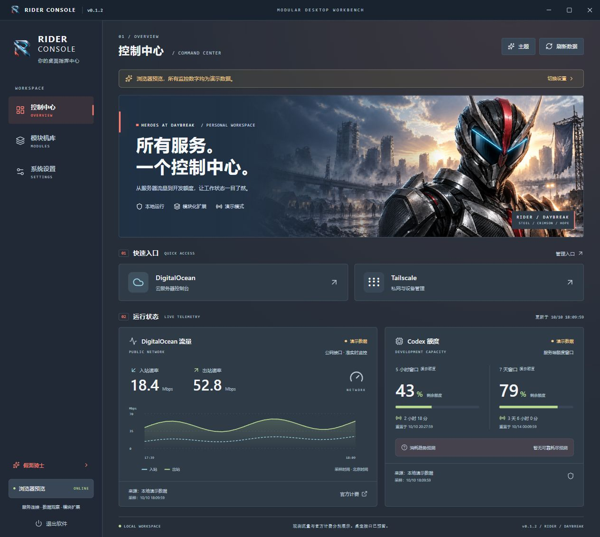

# Rider Console · Windows 软件集成中心

一个可扩展的桌面工作台，把常用网站、服务器流量与 Codex 额度放在同一界面。当前版本 **0.1.2**，使用 Electron + React + TypeScript，提供独立软件图标与四套可切换主题：英雄骑士、透光海底、Gauss Prime 动能冲刺、暖色流萤。



| 主题                                            | 界面与主视觉                               |
| ----------------------------------------------- | ------------------------------------------ |
| 假面骑士                                        | 钢蓝灰界面，黑红锐角装甲与末日晨光         |
| [深海迷航](docs/assets/theme-abyss-demo.png)    | 浅海蓝、透光海底、珊瑚与潜航器             |
| [Gauss Prime](docs/assets/theme-gauss-demo.png) | 白银青蓝、追动外观灵感、冲刺残影与热能爆发 |
| [流萤](docs/assets/theme-firefly-demo.png)      | 奶油白、桃色、薄荷绿与日光花园             |

在“主题”或“系统设置”中选择图片卡片即可预览，保存后保留；离开设置页放弃未保存的修改。旧 Arctic 配置自动迁移为深海主题。角色图由 AI 生成，为同人概念美术；视频依据和精确提示词见 [最终生成记录](docs/concepts/THEME-GENERATION-FINAL.md)。

## 已实现

- DigitalOcean、Tailscale 网站卡片，在系统默认浏览器中打开；支持添加和删除其他 HTTPS 网站。
- DigitalOcean 公网入站 / 出站速率、近 30 分钟趋势、采样时间与连接状态；支持 Mbps / MB/s。
- Codex CLI 自动发现、官方额度读取、动态额度窗口、官方重置倒计时和有足够样本时的消耗预测。
- 模块开关、配置保存、Windows 托盘、显式退出、独立演示模式。
- DO Token 在主进程通过 Windows DPAPI 加密保存，界面不取得已保存的 Token。

**当前边界：**DO 默认未配置，需要自己的只读 Token 和 Droplet ID 才能显示真实流量。本版没有 vnStat 日月累计、SQLite 历史、告警、第三方插件加载器或桌宠窗口；已保留快照订阅边界供后续桌宠使用。Codex 消耗预测与官方重置时间分别处理，预测不是服务承诺。

## 使用

Windows x64 便携版运行 `RiderConsole-0.1.2-portable.exe`，或者运行展开目录中的 `Rider Console.exe`。本机桌面已有 `Rider Console` 快捷方式，指向固定的展开目录。初版未签名，尚未做安装器和自动更新。

1. 打开工作台即可点击网站卡片。
2. 在“系统设置”填入 DO Droplet ID 与包含 `monitoring:read` 权限的只读 Token，保存后读取流量。
3. Codex 默认自动查找本机 CLI。若未找到，填写 `codex.exe` 的完整路径，确保 CLI 已登录目标账户。
4. “模块机库”中可停用监控。关闭窗口默认收起到托盘；从托盘或侧栏“退出软件”完全退出。
5. 需要查看样式时可开启演示模式；演示数字有明确标记。未配置和读取失败不会自动切换为演示。

DO 指标为云端**准实时监控**，采样延迟需以实际接口返回为准；它不等于 DigitalOcean 官方计费累计。官方计费有独立入口。

## 本机目录

| 用途               | 路径                                   |
| ------------------ | -------------------------------------- |
| Git 源码           | `D:\software\software_integration`     |
| 便携软件与展开版本 | `D:\software\RiderConsole\releases`    |
| 独立开发依赖       | `D:\software\RiderConsole\development` |
| 工具与缓存         | `D:\software\RiderConsole\tooling`     |
| 私有验证证据       | `D:\software\RiderConsole\validation`  |

工具不修改系统 PATH 或既有 Node、Python、Conda、Codex 配置。运行时设置由 Electron 保存到当前用户的应用数据目录，独立于源码和发行文件。凭据与验证数据不提交到公共仓库。

本机依赖通过源码目录下的 node_modules 目录联接连接到独立开发目录。更新依赖时先修改源码的 package.json / 锁文件，再运行 `powershell -File scripts/setup-development.ps1`；该脚本在独立目录安装依赖。直接在源码目录执行 npm install / ci 可能替换目录联接，其他电脑使用普通 npm ci 则不受影响。

## 从源码开发

建议 Node.js 24 和 npm；在项目目录执行：

```powershell
npm ci
npm test
npm run build
npm run dev:desktop
```

只预览网页界面：`npm run dev`。网页预览始终使用演示数据，不能保存真实 Token。

```powershell
npm run package:win  # 展开版本
npm run portable:win # 便携 EXE
```

默认发行到同级 `RiderConsole/releases`；可使用 electron-builder 的 `--config.directories.output` 覆盖。锁文件固定依赖版本，仓库附带 docs/ci/check.yml 自动检查模板，当前尚未启用 GitHub Actions。

## 文档与依据

- [项目设计](docs/PROJECT_DESIGN.md)：整体产品与后续路线；尚未实现的设计有标记。
- [首版实现与扩展指南](docs/IMPLEMENTATION.md)：模块边界、数据状态、凭据、预测条件与验证。
- [开源项目调研](docs/OPEN_SOURCE_RESEARCH.md)：vnStat、Beszel、Netdata 与 DO 专用看板选型。
- 官方依据：[DigitalOcean Monitoring API](https://docs.digitalocean.com/reference/api/reference/monitoring/)、[Codex App Server](https://developers.openai.com/codex/app-server)、[Electron safeStorage](https://www.electronjs.org/docs/latest/api/safe-storage)。

界面层次参考 [Arwes](https://github.com/arwes/arwes) 和 [Astro Sci-Fi UI](https://github.com/jonnysmillie/astro-sci-fi-ui)。0.1.2 四主题图片与独立透明图标使用内置 image_gen 生成；骑士保留 A 主体与 F 眼部身份，Gauss 参考实际检查的皮肤配色与运动视频。侧栏、Windows 与托盘使用独立标识。候选与选择记录见 [视觉方案](docs/VISUAL_CONCEPTS.md)，精确提示词和参考视频见 [最终生成记录](docs/concepts/THEME-GENERATION-FINAL.md)。
