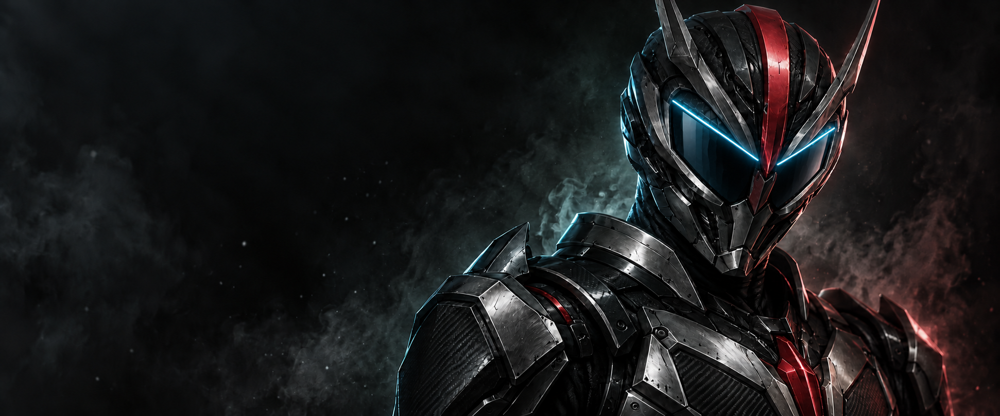
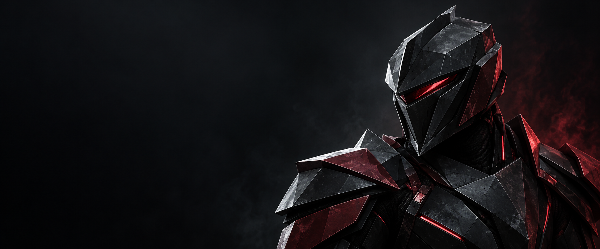
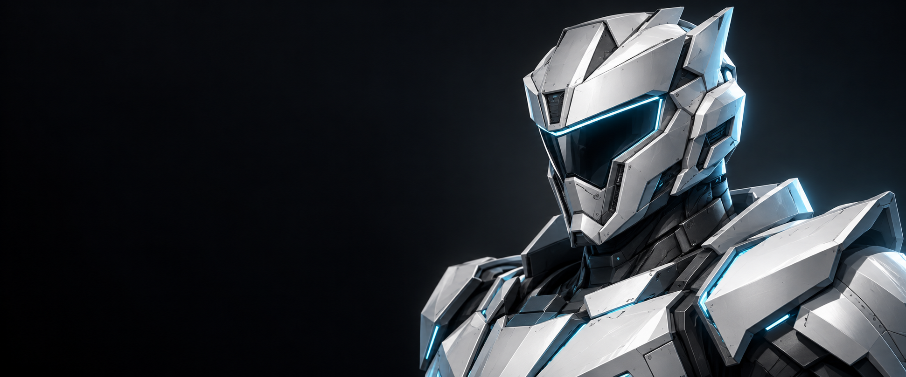
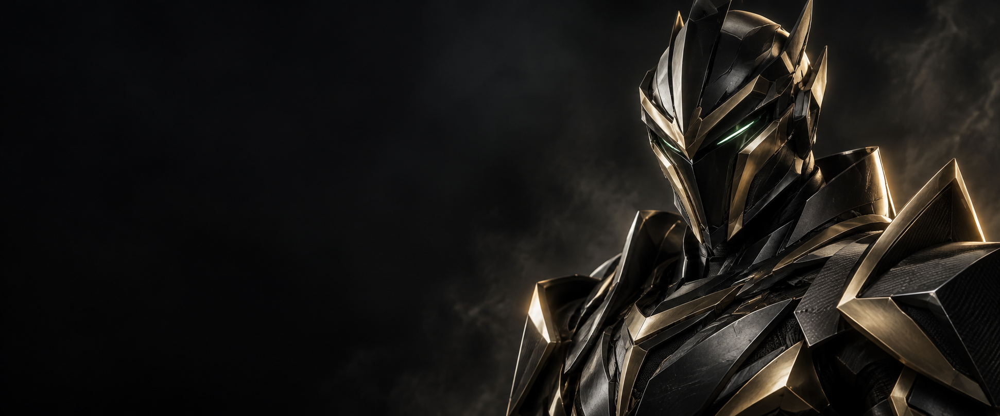
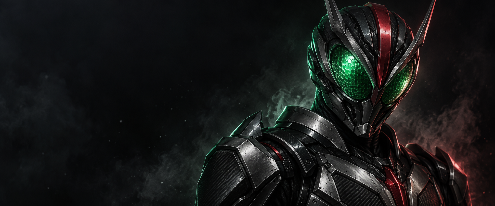
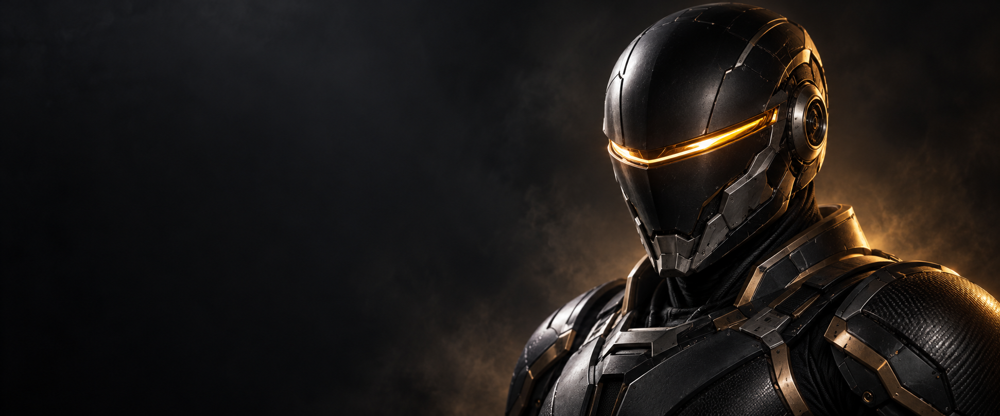
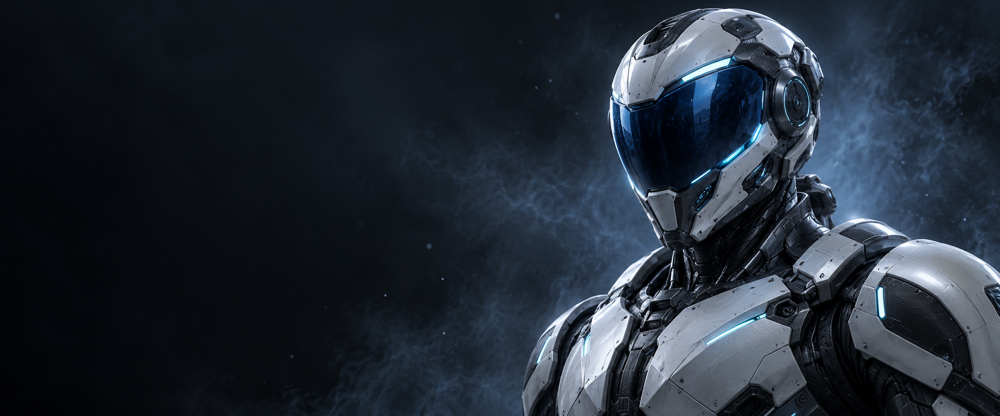
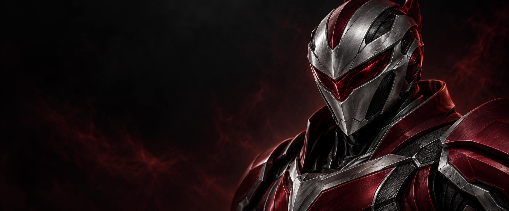

# Rider Console 主视觉候选

2026-10-10，使用内置 image_gen 生成。用户希望第一张作为主体并结合 F 的眼部，因此本轮按 A 的黑红装甲、材质和光影融合 F 的深色面屏与蓝色斜向光带，接入版本 0.1.1。E、F、G 的整套装甲未被选作主体。

## 已接入 · A + F

保留 A 的装甲层次和右侧构图，去掉复眼纹理；首页采用大幅图片，侧栏、Windows 与托盘使用同一主视觉的脸部裁切。精确编辑提示词与来源见 [AF-FUSION-PROMPT.md](concepts/AF-FUSION-PROMPT.md)。下方保留各候选供后续迭代。

| 方案 | 方向     | 特征                                 |
| ---- | -------- | ------------------------------------ |
| E    | 黑红锐刃 | 大块切削折面、楔形面甲、红色窄视窗   |
| F    | 冰白切面 | 白色精密装甲、蓝色光带、分层硬边结构 |
| G    | 黑金锋铠 | 黑金锐边、狭长绿光视窗、尖锐肩甲     |
| A    | 绿眼装甲 | 第一张复眼概念，曲面较多             |
| B    | 琥珀光带 | 黑色面甲和单条琥珀光带，曲面较多     |
| C    | 冷蓝工业 | 蓝色面屏与白色装甲，曲面较多         |
| D    | 银红骑士 | 银色面甲与红色装甲，折面强于 A–C     |

## E · 黑红锐刃

## F · 冰白切面

## G · 黑金锋铠

## 前一组

候选生成提示词保存在 [PROMPTS.md](concepts/PROMPTS.md)。素材均已复制到项目目录，生成原文件保留。0.1.1 已调整首页图片布局、小尺寸标识、发行文件和桌面快捷方式图标。
